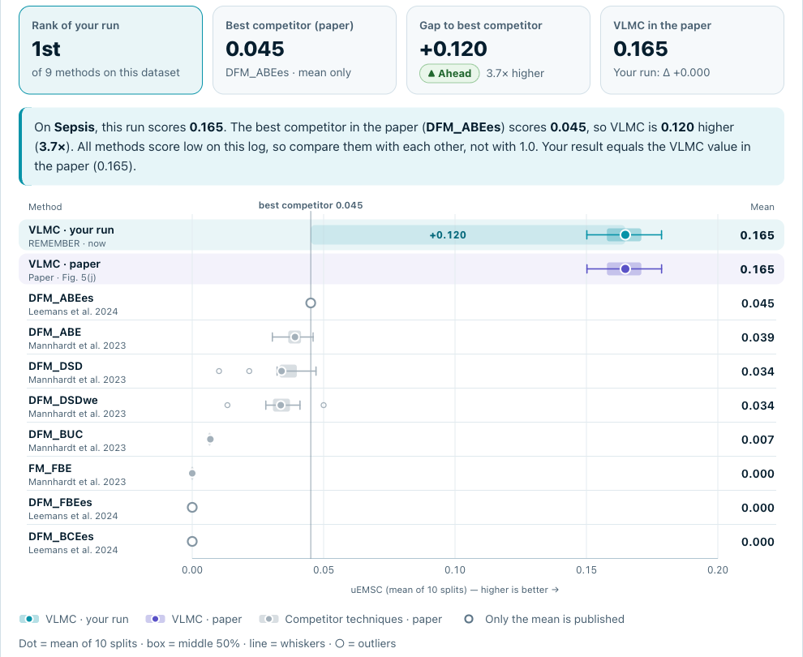

<p align="center">
  <picture>
    <source media="(prefers-color-scheme: dark)" srcset="docs/logo-dark.png">
    
  </picture>
</p>

<p align="center">
  <a href="https://hub.docker.com/r/remembericpm/remember"></a>
  <a href="LICENSE"></a>
  <a href="https://doi.org/10.5281/zenodo.23952118"></a>
  <a href="https://doi.org/10.1016/j.is.2025.102561"></a>
  <a href="https://youtu.be/8kGus_JzCN4"></a>
</p>

REMEMBER is a tool for stochastic conformance checking. It learns a Variable-Length Markov
Chain (VLMC) from a reference event log and measures how well other logs agree with it, using
the unit Earth Movers' Stochastic Conformance (uEMSC) and three diagnostics. It implements the
method of Incerto, Vandin and Sarv Ahrabi (*Information Systems* 133, 2025) and reproduces the
published results on the 11 benchmark logs of that paper.

REMEMBER runs on your computer and is used from the browser. You write no code and tune no
parameter: the VLMC is always learned with the setting of the paper's experiments. A
[four-minute video](https://youtu.be/8kGus_JzCN4) shows the tool in use.

<p align="center">
  
  <br><sub>A re-run of the Sepsis benchmark, next to the published VLMC result and eight other techniques.</sub>
</p>

## Quick start

### With Docker

```bash
docker run --rm -p 127.0.0.1:7860:7860 remembericpm/remember:3.7
```

Then open <http://localhost:7860>. The image (about 100 MB) contains Java, Python, the example
and the benchmarks, and runs on x86-64 and ARM machines, Apple silicon included. Ctrl+C stops it.
For another port, change only the first number (`-p 127.0.0.1:8080:7860`, then open
<http://localhost:8080>).

### Without Docker

Install Java 17 or newer (for example [Temurin](https://adoptium.net)) and Python 3.11 to 3.14,
download this repository or the archived package on
[Zenodo](https://doi.org/10.5281/zenodo.23952118), and start the launcher for your system.

| System | Launcher |
|---|---|
| macOS | double-click `run_mac.command` |
| Windows | double-click `run_windows.bat` |
| Linux | `bash run_unix.sh` |

The first start installs Flask, pandas and NumPy (about 25 MB) in a private `.venv` folder and
takes a few minutes. The browser then opens at <http://127.0.0.1:7860>, or at the next free port
if 7860 is taken. Ctrl+C in the launcher window stops REMEMBER.

<details>
<summary>macOS or Windows does not open the launcher</summary>

- **macOS** (*cannot verify the developer* or *you do not have permission*): open Terminal,
  type `bash` followed by a space, drag `run_mac.command` into the window and press Enter. If
  Terminal asks for access to a folder, click OK.
- **Windows** (*Windows protected your PC*): click **More info**, then **Run anyway**.

</details>

### Check the installation

```bash
docker run --rm remembericpm/remember:3.7 python verify_sample.py   # Docker
.venv/bin/python verify_sample.py                                   # macOS, Linux
.venv\Scripts\python.exe verify_sample.py                           # Windows
```

The output must end with `All checks passed.`

## Using REMEMBER

Under **Choose what to run**, pick one of three paths.

| Path | You provide | REMEMBER |
|---|---|---|
| **Your logs** | one reference log and one or more logs to check | learns the VLMC from the reference log and scores every log to check |
| **Example** | nothing | runs the included example: one reference log and three small logs to check |
| **Paper benchmarks** | a dataset | reruns the 10 splits of the paper and compares your result with the published ones |

The logs to check are only scored, never used for learning.

### Logs

REMEMBER reads XES, CSV and TXT logs, also gzipped, and uses only the control flow: case,
activity and event order.

| Format | Read by default |
|---|---|
| XES | case id from the `concept:name` of each trace; activity and time from the `concept:name` and `time:timestamp` of each event |
| CSV | columns found automatically, such as `case_id`, `activity`, `timestamp` or the XES names; the separator (`,` `;` tab) is detected |
| TXT | activity tokens, each trace closed by `end$`; a log already in the paper's format (`!$ activity$ … end$`) is used as is |

If your logs use other names, open **Column and attribute names** and type them; empty fields
keep the defaults, and the names apply to every uploaded log. In XES, a case id missing from a
trace is read from its events, so events can also be grouped by an event attribute. A name that
does not exist in a file gives an error that lists the names the file contains.

Events are sorted by timestamp within each case, and events with the same timestamp keep their
order in the file. A CSV without a timestamp column keeps the row order, and the page says so.
Activity names are cleaned as in the paper's code: the characters
`space _ & $ ( ) { } [ ] - + . ; '` are removed, so *Send Fine* and *Send-Fine* become the same
activity. Other characters, such as `/` or `é`, are removed too, and a short code is added so
that different names stay different.

### Results

| Value | Meaning | Better |
|---|---|---|
| **uEMSC** | main score; 1 means full stochastic agreement | higher |
| **ER-U** | Entropic Relevance with uniform background, in bits per trace (Alkhammash et al., 2022) | lower |
| **Predictive perplexity** | how well the VLMC predicts each next activity, on the traces it can generate; 1 is perfect | lower |
| **Trace support** | share of traces that the VLMC can generate | higher |

With several logs to check, the summary shows the unweighted mean and the **Per log** table
lists each log. For a benchmark, uEMSC is the mean ± sample standard deviation over the 10
splits, and every split is listed. **Download results (CSV)** saves the table, and the ⓘ next to
each measure gives its definition. Times include the start of Java, so they are not meant for
comparing methods.

## Paper benchmarks

`data/benchmarks/` holds the 11 datasets of the paper. Each one has 10 reference/check splits of
about equal size, taken from the supplementary material of Mannhardt et al.
([10.5281/zenodo.7578655](https://doi.org/10.5281/zenodo.7578655)) and identical to those of the
paper's replication code. For every split, REMEMBER learns a new VLMC from the reference half
and scores the check half.

| Dataset | uEMSC (mean ± SD) | Paper | Figure | ER-U (bits/trace) |
|---|---:|---:|---|---:|
| BPIC12-A | 0.9776 ± 0.0052 | 0.9776 | Fig. 4(a) | 2.848 |
| BPIC13 Incidents | 0.6523 ± 0.0061 | 0.6523 | Fig. 4(b) | 23.927 |
| BPIC13 Open Problems | 0.6930 ± 0.0113 | 0.6930 | Fig. 4(c) | 7.544 |
| BPIC13 Closed Problems | 0.7249 ± 0.0113 | 0.7249 | Fig. 4(d) | 9.714 |
| BPIC17 Offer Log | 0.9900 ± 0.0027 | 0.9900 | Fig. 4(e) | 2.187 |
| BPIC20 Domestic Declarations | 0.9675 ± 0.0076 | 0.9675 | Fig. 4(f) | 2.867 |
| BPIC20 International Declarations | 0.8160 ± 0.0062 | 0.8160 | Fig. 4(g) | 12.850 |
| BPIC20 Prepaid Travel Cost | 0.8380 ± 0.0132 | 0.8380 | Fig. 4(h) | 9.046 |
| BPIC20 Request for Payment | 0.9598 ± 0.0059 | 0.9598 | Fig. 5(i) | 3.027 |
| Sepsis | 0.1648 ± 0.0093 | 0.1648 | Fig. 5(j) | 58.791 |
| Road Traffic Fines | 0.9901 ± 0.0018 | 0.9901 | Fig. 5(k) | 2.752 |

SD is the sample standard deviation over the 10 splits; *Paper* is the VLMC mean in the figure
of the paper.

**Equal timestamps.** The paper's code sorted events with a sort that is not stable, so the
order of events with the same timestamp, and with it some results, could change from one
machine to another. Each dataset therefore also ships its splits in the event order of the
published results (`paper/*.txt.gz`). REMEMBER uses these files, so every machine gives the
published values. If they are missing, it converts the XES files itself and shows a notice. The
Docker image contains only the `paper/` files.

**Comparison with the paper.** After a benchmark run, this view places your run next to the
published VLMC result and the eight competitor techniques of the paper, as box plots over the 10
splits, with your rank and the gap to the best competitor. A second view covers all 11 datasets;
in the paper, the VLMC is best on all of them except BPIC13 Open Problems.
**Download comparison (CSV)** saves the published values and your runs. The published values
(`data/benchmarks/paper_reference_results.json`) were read from the vector data of Figs. 4 and 5
of the paper, to about ±0.001. For the three techniques of Leemans et al. (2024), the paper gives
only the mean.

**Command line.** The same runs work without the browser:

```bash
.venv/bin/python benchmark_runner.py                          # list the datasets
.venv/bin/python benchmark_runner.py sepsis                   # one dataset
.venv/bin/python benchmark_runner.py all --csv results.csv    # all 11, every split in a CSV
docker run --rm remembericpm/remember:3.7 python benchmark_runner.py sepsis   # with Docker
```

On Windows, use `.venv\Scripts\python.exe`. On an Apple M1 Pro laptop, a dataset takes from
3.5 s (BPIC13 Open Problems) to 140 s (Road Traffic Fines), and all 11 take about 6 minutes. As
in the paper, the VLMC is not pruned, so the models are large.

## How the scores are computed

As in the paper's code, each trace becomes `!$ activity_1$ … activity_n$ end$`. The start symbol
`!$` is the first context, so the first activity counts in the likelihood, and `end$` closes the
trace. Cases follow the sorted order of their case ids.

For each distinct trace t of a log to check, the engine gives its likelihood M(t) under the
VLMC, and L(t) is its frequency in the log. Then

> uEMSC = 1 − Σ<sub>t</sub> max(L(t) − M(t), 0)

with both values rounded to six decimals, as in the paper's code. The diagnostics use the same
likelihoods at full precision, so they never change uEMSC.

## Example results

The included example (`data/samples/`) gives these values, which `verify_sample.py` checks.
They show that an installation works; they are not a scientific reference.

| Log to check | uEMSC | ER-U (bits/trace) | Predictive perplexity | Trace support |
|---|---:|---:|---:|---:|
| `check_1.xes` | 0.986666 | 1.404394 | 1.214935 | 30/30 |
| `check_2.xes` | 0.773334 | 1.691551 | 1.264275 | 30/30 |
| `check_3.xes` | 0.566666 | 9.053966 | 1.240718 | 17/30 |

## Troubleshooting

| Problem | What to do |
|---|---|
| *Java 17 or newer was not found* | Install Java 17 or newer ([Temurin](https://adoptium.net)) and start again. `python3 java_runtime.py` (Windows: `py java_runtime.py`) shows which Java is found. |
| *Python 3.11 or newer was not found* | Install Python from <https://www.python.org/downloads/>; on Windows, tick *Add python.exe to PATH*. |
| *Package installation failed* | Check the internet connection and start again. |
| The browser does not open | Open the address printed in the launcher window. |
| Errors after an update | Close every REMEMBER window (Ctrl+C) and start again. If that is not enough, delete `.venv`. |

Uploaded logs are copied to a temporary folder and deleted after each run. REMEMBER accepts
connections only from your own computer (`127.0.0.1`, also in the Docker command above).

## Repository contents

| Path | Content |
|---|---|
| `app.py`, `templates/`, `static/` | local web interface (Flask) |
| `remember_engine.py` | the paper's pipeline: Java engine and uEMSC |
| `trace_io.py` | reading XES, CSV and TXT logs |
| `metrics.py` | ER-U, predictive perplexity, trace support |
| `benchmark_runner.py` | paper benchmarks, from the page or the command line |
| `run_mac.command`, `run_windows.bat`, `run_unix.sh`, `java_runtime.py` | launchers, and the search for Java |
| `verify_sample.py` | installation check |
| `engine/` | Java engine of the paper (`jfitVlmc-paper.jar`, `trace2ecf-paper.jar`), its licence, and the source code of its copyleft libraries |
| `data/samples/` | included example and its expected results |
| `data/benchmarks/` | 11 datasets × 10 splits (XES, and in `paper/` the paper's event order) and the published results |
| `Dockerfile`, `docker_image.sh`, `docker_smoke_test.py` | Docker image; `bash docker_image.sh` lists the commands to build, test and publish it |
| `docs/` | images of this README |
| `LICENSE`, `NOTICE`, `THIRD_PARTY_NOTICES.md`, `CITATION.cff` | licence, copyright and additional terms, origin and licences of engine and data, citation metadata |

## Citing REMEMBER

If you use REMEMBER or its results, please cite the paper. The **Cite us** button on the page
gives the reference and the BibTeX entry, and `CITATION.cff` holds the same metadata. To cite
this version of the software, use its Zenodo DOI [10.5281/zenodo.23952118](https://doi.org/10.5281/zenodo.23952118).

```bibtex
@article{DBLP:journals/is/IncertoVA25,
  author       = {Emilio Incerto and
                  Andrea Vandin and
                  Sima Sarv Ahrabi},
  title        = {Stochastic conformance checking based on variable-length Markov chains},
  journal      = {Inf. Syst.},
  volume       = {133},
  pages        = {102561},
  year         = {2025},
  url          = {https://doi.org/10.1016/j.is.2025.102561},
  doi          = {10.1016/J.IS.2025.102561},
  timestamp    = {Tue, 24 Mar 2026 08:46:40 +0100},
  biburl       = {https://dblp.org/rec/journals/is/IncertoVA25.bib},
  bibsource    = {dblp computer science bibliography, https://dblp.org}
}
```

## Licence

REMEMBER — Copyright © 2026 Emilio Incerto¹, Andrea Vandin²˒³, Sima Sarv Ahrabi²

<sub>¹ IMT School for Advanced Studies Lucca, Italy · ² L'EMbeDS and Institute of Economics, Sant'Anna School for Advanced
Studies, Pisa, Italy · ³ DTU Technical University of Denmark, Kongens Lyngby, Denmark</sub>

REMEMBER is free software: you can redistribute it and/or modify it under the terms of the GNU
General Public License as published by the Free Software Foundation, either version 3 of the
License, or (at your option) any later version. REMEMBER is distributed in the hope that it will
be useful, but WITHOUT ANY WARRANTY; without even the implied warranty of MERCHANTABILITY or
FITNESS FOR A PARTICULAR PURPOSE. See the GNU General Public License for more details: file
`LICENSE`, also shown by the *Licence* link on the page.

**Additional terms** (GNU GPL v3, section 7; full text in `NOTICE`): a modified version must
not be distributed under the name "REMEMBER", and the licence grants no trademark rights for the
name or the logo. You may still say that your work is based on REMEMBER.

The Java engine and the benchmark data keep their own licences. `THIRD_PARTY_NOTICES.md` lists
them and says where to find the source code of the engine and of its libraries.

## References

- E. Incerto, A. Vandin, S. Sarv Ahrabi. *Stochastic conformance checking based on
  variable-length Markov chains.* Information Systems 133 (2025) 102561.
  <https://doi.org/10.1016/j.is.2025.102561>
- Replication package of the paper: <https://doi.org/10.5281/zenodo.13348234>
- F. Mannhardt, S.J.J. Leemans, C.T. Schwanen, M. de Leoni. *Modelling data-aware
  stochastic processes — discovery and conformance checking.* In: Application and Theory
  of Petri Nets and Concurrency (PETRI NETS 2023), Springer, pp. 77–98.
  Supplementary material: <https://doi.org/10.5281/zenodo.7578655>
- H. Alkhammash, A. Polyvyanyy, A. Moffat, L. García-Bañuelos. *Entropic relevance:
  A mechanism for measuring stochastic process models discovered from event data.*
  Information Systems 107 (2022) 101922.
